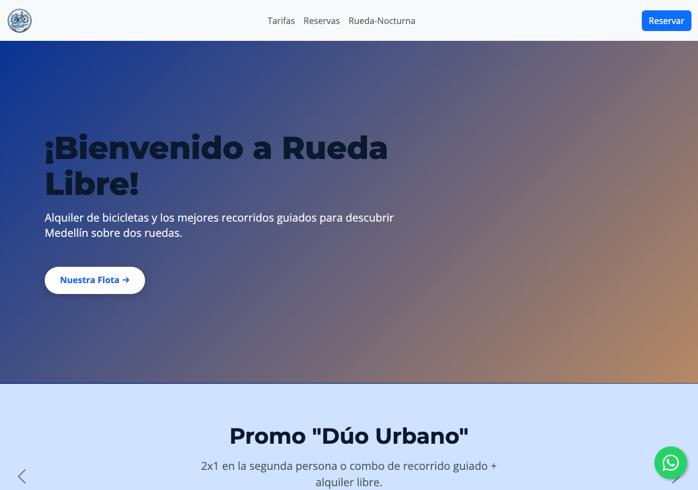
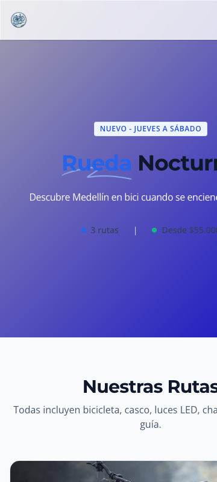
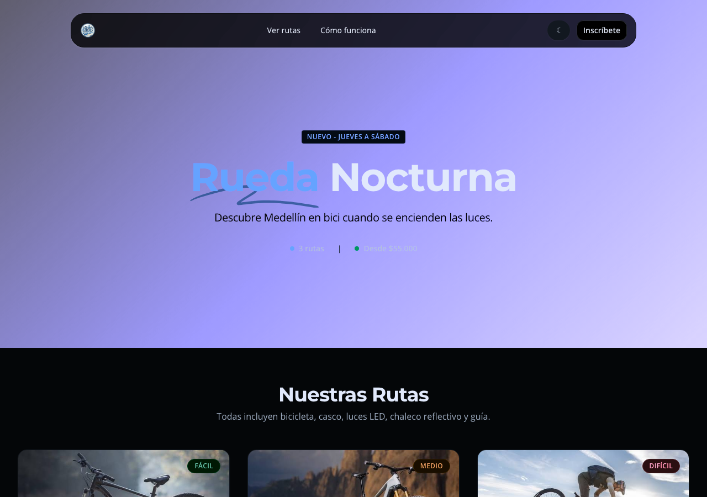

# 🚴 Rueda Libre · Movilidad Sostenible & Rueda Nocturna

[](https://developer.mozilla.org/en-US/docs/Web/HTML)
[](https://developer.mozilla.org/en-US/docs/Web/CSS)
[](https://developer.mozilla.org/en-US/docs/Web/JavaScript)
[](https://getbootstrap.com/)
[](https://tailwindcss.com/)
[](https://pages.github.com/)

---

## 📌 1. Project Overview

**Rueda Libre** es un emprendimiento paisa concebido para transformar la movilidad urbana en Medellín, Colombia. A través del alquiler flexible de bicicletas y recorridos turísticos guiados por expertos locales, la plataforma conecta a viajeros y ciudadanos con el patrimonio cultural, arquitectónico y natural de la ciudad (Laureles, El Poblado, Envigado).

Como parte de su expansión estratégica, se desarrolló la campaña **Rueda Nocturna**: una experiencia nocturna diferencial (operativa de jueves a sábado) que invita a recorrer la ciudad bajo el alumbrado urbano a través de tres rutas exclusivas (*Luces del Centro*, *Miradores de la Ciudad* y *Luna en Las Palmas*).

Este repositorio documenta la evolución técnica, arquitectónica y visual del ecosistema web de Rueda Libre, integrando dos paradigmas front-end complementarios: una plataforma corporativa multi-página impulsada por **Bootstrap 5.3.3** y una landing page de alta conversión desarrollada con **Tailwind CSS**.

---

## 🌐 2. Live URLs (GitHub Pages)

Accede a las aplicaciones desplegadas en producción a través de los siguientes enlaces oficiales:

| Entorno / Página | Enlace Directo | Framework / Enfoque |
| :--- | :--- | :--- |
| 🏠 **Portal Principal (Home)** | [Ver Sitio Principal](https://alejoia20257bedo-byte.github.io/rueda-libre-bootstrap/) | Bootstrap 5.3.3 · Plataforma corporativa |
| 🌙 **Campaña Rueda Nocturna** | [Ver Landing Rueda Nocturna](https://alejoia20257bedo-byte.github.io/rueda-libre-bootstrap/nocturna/prototipo.html) | Tailwind CSS · Campaña & Microinteracciones |
| 💰 **Tarifas de Alquiler & Rutas** | [Ver Tarifas](https://alejoia20257bedo-byte.github.io/rueda-libre-bootstrap/tarifas.html) | Bootstrap 5.3.3 · Tablas interactivas |
| 📝 **Sistema de Reservas** | [Ver Reservas](https://alejoia20257bedo-byte.github.io/rueda-libre-bootstrap/reservas.html) | Bootstrap 5.3.3 · Validación accesible |
| 📋 **Formulario de Inscripción Nocturna** | [Ver Inscripción Nocturna](https://alejoia20257bedo-byte.github.io/rueda-libre-bootstrap/nocturna/form.html) | Tailwind CSS · Formulario de conversión |
| 🧩 **Kit de Componentes UI** | [Ver Componentes](https://alejoia20257bedo-byte.github.io/rueda-libre-bootstrap/nocturna/componentes.html) | Tailwind CSS · Design System modular |

---

## 🏛️ 3. Architecture & Pages

El proyecto adopta una arquitectura desacoplada por carpetas para aislar los contextos de negocio, frameworks y ciclos de vida de diseño:

```
rueda-libre-bootstrap/
├── index.html                   # Portal corporativo (Hero, carrusel, flota, beneficios, footer)
├── tarifas.html                 # Matriz de precios por hora/día y paquetes de rutas guiadas
├── reservas.html                # Formulario transaccional con validación en tiempo real y modal
├── practice.html                # Sandbox de prototipado y pruebas de componentes
├── bitacora.txt                 # Registro histórico de depuración y refactorización
├── resources/                   # Recursos compartidos y activos estáticos
│   ├── css/
│   │   ├── style.css            # Tokens :root, tipografía base y reglas personalizadas
│   │   └── nocturna.css         # Lógica CSS para filtro e inversión de Dark Mode
│   ├── js/
│   │   └── functionality.js     # Validaciones de formulario, cálculo de fechas y modal accesible
│   ├── icons/
│   │   └── icon.png             # Isotipo y favicons de marca
│   └── images/                  # Catálogo de flota (img1–img7), hero y fotografías corporativas
├── nocturna/                    # Subdirectorio exclusivo para la campaña "Rueda Nocturna"
│   ├── prototipo.html           # Landing page de campaña con Play CDN, Dark Mode y catálogo de rutas
│   ├── form.html                # Formulario dedicado de registro nocturno
│   └── componentes.html         # Catálogo de componentes atómicos (botones, tarjetas, badges)
└── docs/
    └── screenshots/             # Evidencias visuales de pruebas de maquetación y responsividad
        ├── desktop_preview.png
        ├── mobile_preview.png
        └── dark_mode_preview.png
```

### Relación entre Páginas y Flujos de Usuario
1. **Flujo Corporativo (`/`):** El usuario navega desde `index.html` conociendo la flota, consulta en `tarifas.html` los precios y formaliza su alquiler en `reservas.html`.
2. **Flujo de Campaña (`/nocturna/`):** Un banner promocional en el Navbar conduce a `prototipo.html`. Allí se exhiben las rutas nocturnas, el selector de modo noche/día (`☾ / ☼`), el flujo paso a paso de alquiler y el botón directo a `form.html` para captura de leads.
3. **Persistencia Tipográfica y Visual:** Ambas arquitecturas comparten la misma paleta institucional y jerarquía tipográfica Google Fonts (**Montserrat** para encabezados, **Open Sans** para especificaciones y lectura continua).

---

## 💻 4. Tech Stack

| Tecnología | Rol en el Proyecto | Implementación Técnica Destacada |
| :--- | :--- | :--- |
| **Bootstrap 5 (v5.3.3)** | Core Platform UI & Layout | Sistema de rejilla flexible (`row-cols-*`, `g-4`), componentes accesibles (`carousel-dark`, `alert`, `table-striped`), y wrappers responsivos (`ratio ratio-4x3 ratio-md-16x9`). |
| **Tailwind CSS (v4 / Play CDN)** | Campaign Landing & Design System | Utilidades atómicas JIT, `@theme`, `@apply`, variantes responsivas fluidas (`sm`, `md`, `lg`), microinteracciones con escalado hover (`group-hover:scale-[15]`) y configuración dinámica en runtime. |
| **HTML5 Semántico & Accesibilidad** | Estructura & WCAG 2.1 AA | Jerarquía estricta (`h1` único por documento), etiquetas de contenido (`<header>`, `<nav>`, `<main>`, `<article>`, `<dl>`, `<dt>`, `<dd>`, `<footer>`), atributos `aria-*` y estados de foco visibles. |
| **Vanilla CSS Custom Properties** | Design Tokens (`:root`) | Variables globales para colores (`--color-primary`, `--rl-dark`), tipografías (`--font-heading`, `--font-body`) y escalas de espaciado modular (`--space-sm` a `--space-xl`). |
| **JavaScript (ES6+)** | Interactividad & Lógica de Negocio | Validación nativa con clase Bootstrap `.was-validated`, sincronización de slider de edad, cálculo de fecha mínima en hora local (evitando desfase UTC) y toggle de Dark Mode con persistencia en el DOM. |
| **Google Fonts API** | Tipografía Corporativa | Carga optimizada mediante `preconnect`: **Montserrat** (300..900) para impacto visual y **Open Sans** (300..800) para legibilidad óptima. |

---

## 📊 5. Framework Recommendation Report (MiniReto 8)

Como parte de la evolución tecnológica del proyecto, se elaboró un análisis comparativo multidimensional entre **Bootstrap 5** y **Tailwind CSS v4** para orientar la hoja de ruta técnica de Rueda Libre.

```
                  COMPARATIVA TÉCNICA FRONT-END
   ┌─────────────────────────────────────────────────────────┐
   │  Bootstrap 5: Component-Driven  vs  Tailwind: Utility-First  │
   └─────────────────────────────────────────────────────────┘
```

| Criterio de Evaluación | Bootstrap 5.3.3 | Tailwind CSS v4 |
| :--- | :--- | :--- |
| **1. Curva de Aprendizaje** | **Baja y Predecible.** Proporciona componentes preconstruidos listos para usar (`.btn`, `.card`, `.navbar`, `.modal`). Cualquier desarrollador junior puede maquetar interfaces funcionales en minutos sin profundizar en reglas CSS avanzadas. | **Moderada a Pronunciada al inicio.** Exige familiarizarse con cientos de utilidades atómicas (`flex`, `items-center`, `gap-x-4`, `ring-inset`). Sin embargo, una vez dominada, elimina totalmente la fricción de inventar nombres de clases semánticas. |
| **2. Nivel de Personalización** | **Restringido por Componentes.** Sobrescribir el estilo nativo de Bootstrap requiere alterar variables Sass complejas o redactar reglas CSS con alta especificidad (`!important`). Tiende a generar sitios con apariencia genérica si no se interviene a fondo. | **Infinito y Sin Opinión.** No impone estilos predeterminados. Permite materializar cualquier diseño o microinteracción personalizada directamente en el HTML sin salir del archivo ni pelear contra hojas de estilo externas. |
| **3. Peso del Bundle & Rendimiento** | **Pesado y Estático (~280 KB minificado CSS + JS).** Distribuye toda la biblioteca de componentes independientemente de si se utilizan o no en el proyecto, a menos que se configure un pipeline de PurgeCSS o Sass modular. | **Ultra Ligero (~10–25 KB en producción).** Gracias a su motor Just-In-Time (JIT) y compilador Ahead-of-Time, analiza los archivos fuente y genera estrictamente las clases detectadas en el código, desechando todo lo no utilizado. |
| **4. Casos de Uso Recomendados** | Portales corporativos estandarizados, paneles de administración (dashboards), formularios transaccionales con tablas densas y MVPs que exigen velocidad de entrega inmediata. | Landing pages de marketing de alta conversión, aplicaciones web modernas, experiencias inmersivas interactivas (Dark Mode, animaciones a medida) y Design Systems propietarios. |

### 🎯 Veredicto Justificado para Rueda Libre

> **Recomendación: Arquitectura Híbrida Estratégica.**
>
> 1. **Mantener Bootstrap 5** para el núcleo operativo del negocio (`/index.html`, `/tarifas.html`, `/reservas.html`). Este módulo requiere estabilidad a largo plazo, tablas densas de precios con ordenamiento visual y formularios de reserva tradicionales donde los componentes estándar aceleran el mantenimiento sin incurrir en deuda técnica.
> 2. **Adoptar Tailwind CSS v4** para todas las campañas comerciales, landing pages experimentales y micrositios promocionales (`/nocturna/prototipo.html`, `/nocturna/form.html`). El motor JIT garantiza tiempos de carga ultrarrápidos (cruciales para pauta digital y conversión móvil), permite integrar fácilmente el modo nocturno temático y ofrece total libertad creativa para destacar la identidad visual única de Medellín sobre dos ruedas.

---

## 📸 6. Visual Evidence & Responsive Layouts

A continuación se presentan capturas del diseño implementado, validando la coherencia visual, la legibilidad y la adaptación responsiva en diferentes factores de forma:

### 🖥️ Vista de Escritorio (Desktop Layout · 1280 px)
Diseño equilibrado con barra de navegación flotante tipo cápsula (*backdrop-blur*), tipografía Montserrat en display, grid de tarjetas de flota y navegación clara:


---

### 📱 Vista Móvil Responsiva (Mobile Layout · 360 px)
Adaptación a pantallas ultra estrechas. Menú colapsable accesible, tipografía fluida `clamp()` sin desbordamiento horizontal, imágenes con `object-fit: contain` y botones de acción rápida (*Touch Friendly*):
<p align="center">
  
</p>

---

### 🌙 Modo Oscuro (Dark Mode · Rueda Nocturna)
Implementación mediante filtro algorítmico invertido en `html.dark-mode` con contra-inversión automática en fotografías y recursos multimedia para preservar los colores naturales de las rutas:


---

## 💡 7. Key Learnings & Engineering Takeaways

Durante el ciclo iterativo de auditoría, corrección y homologación técnica del proyecto, se consolidaron los siguientes aprendizajes:

1. **Coexistencia Armónica de Frameworks:** Es perfectamente viable y ventajoso combinar Bootstrap (para transacciones y administración) con Tailwind CSS (para marketing y branding) dentro del mismo repositorio, siempre que los contextos de ejecución y archivos estén claramente delimitados.
2. **Higiene Semántica & Accesibilidad (WCAG):** Corregir fallos de estructura —como extraer elementos anidados indebidamente (`<footer>` dentro de `<footer>`), asegurar un único encabezado `<h1>` por vista y asociar etiquetas `<label>` con sus respectivos `<input>`— eleva drásticamente el posicionamiento SEO y la accesibilidad para lectores de pantalla.
3. **Manejo Seguro de Fechas en Cliente:** El cálculo de fechas mínimas para reservas debe ejecutarse considerando la zona horaria local (`getFullYear()`, `getMonth()`, `getDate()`) en lugar de `toISOString()`, previniendo que reservas nocturnas en Colombia (UTC-5) queden bloqueadas prematuramente.
4. **Optimización de Assets & Grid:** El uso de `ratio ratio-4x3` nativo en iframes de Google Maps y alturas fijas controladas con `object-fit: contain` en tarjetas evita desplazamientos acumulados de diseño (*Cumulative Layout Shift - CLS*), garantizando una experiencia de usuario fluida.

---

## 👨‍💻 8. Author & Credits

* **Desarrollador Lead:** Alejandro ([@alejoia20257bedo-byte](https://github.com/alejoia20257bedo-byte))
* **Organización / Proyecto:** Rueda Libre & Rueda Nocturna Medellín
* **Repositorio:** [github.com/alejoia20257bedo-byte/rueda-libre-bootstrap](https://github.com/alejoia20257bedo-byte/rueda-libre-bootstrap)
* **Licencia:** Proyecto educativo y demostrativo desarrollado con fines de portafolio y buenas prácticas de ingeniería web.

---
<p align="center">
  Hecho con 🚲 y pasión por la movilidad sostenible en Medellín, Colombia · © 2026 Rueda Libre
</p>
